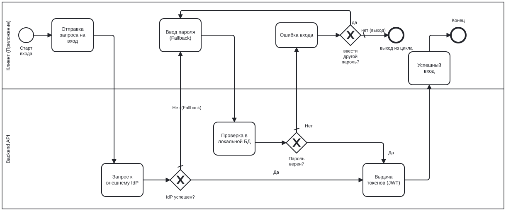
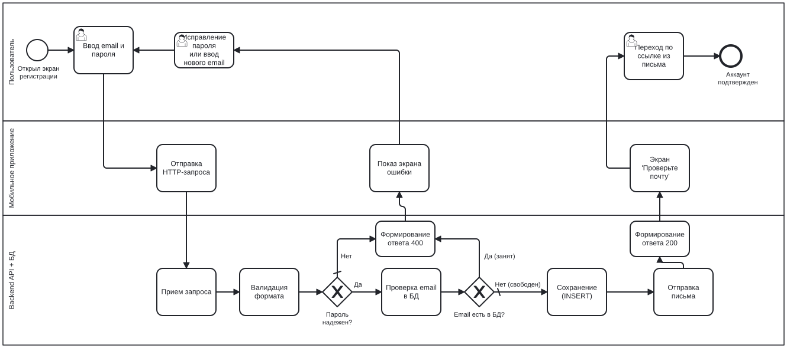
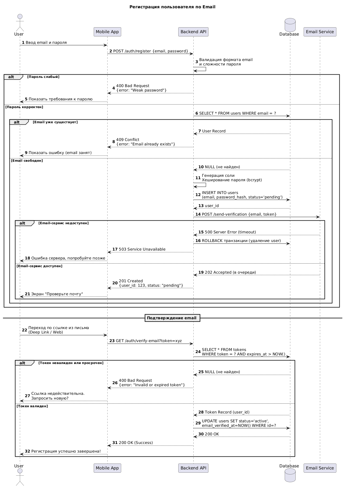

# Проектирование модуля «Личный кабинет» интернет-магазина

Данный репозиторий содержит выполненные задания по проектированию и анализу требований для модуля **«Личный кабинет»** (аутентификация, регистрация, вход через внешние провайдеры).

---

## 📂 Структура репозитория и описание файлов

| Файл / Артефакт | Описание |
| :--- | :--- |
| 📄 **[Task1-SRS.md](Task1-SRS.md)** | **Структура SRS.** Оглавление полной спецификации требований к модулю «Личный кабинет» (13 разделов). Для каждого раздела указаны сопровождающие диаграммы (BPMN, UML, C4). |
| 📄 **[Task2-FR_NFR.md](Task2-FR_NFR.md)** | **Требования и Acceptance Criteria.** Список из 7 функциональных (FR) и 3 нефункциональных (NFR) требований, а также User Story с Acceptance Criteria в формате Given/When/Then. |
| 🖼️ **[BPMN: Регистрация](#1-bpmn-регистрация)** | Схема процесса регистрации пользователя по Email (happy path + обработка ошибок: слабый пароль, email уже существует). |
| 🖼️ **[BPMN: Аутентификация (IdP + Fallback)](#2-bpmn-аутентификация-через-idp)** | Схема входа через внешний IdP с откатом (fallback) на локальную БД при ошибке провайдера. |
| 🖼️ **[UML Sequence Diagram](#3-uml-sequence-diagram)** | Диаграмма последовательности: `Mobile App → Backend API → Database → Email Service`. Показывает логику регистрации, отправки письма и подтверждения email. |

---

## 🖼️ Визуализация диаграмм

### 1. BPMN: Регистрация
*Процесс регистрации пользователя по Email (happy path + обработка ошибок).*

---

### 2. BPMN: Аутентификация через IdP
*Процесс входа через внешний IdP с откатом (fallback) на локальную БД.*

---

### 3. UML Sequence Diagram
*Диаграмма последовательности: Мобильное приложение → Backend API → База данных → Email-сервис.*

